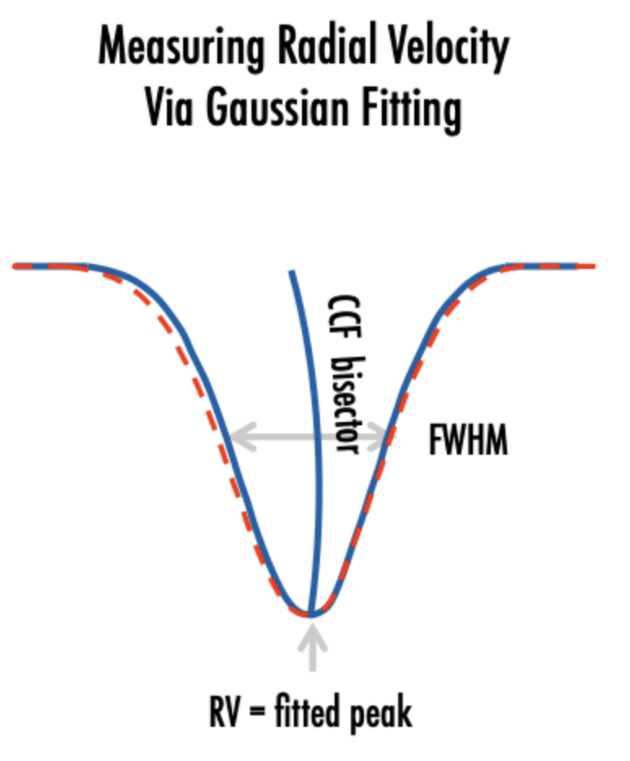
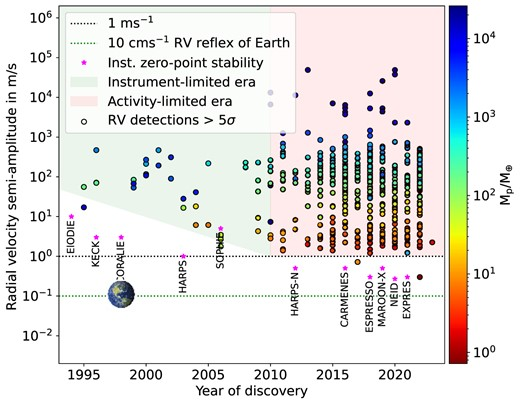
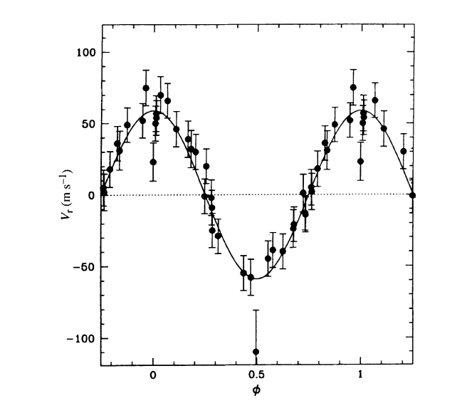
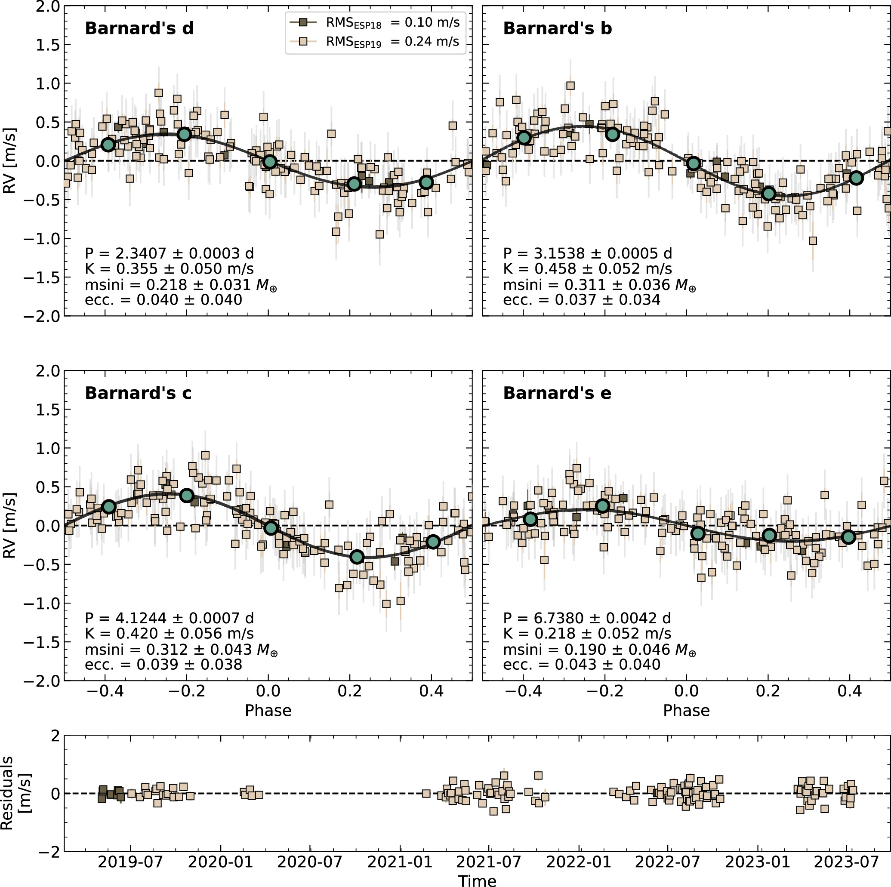
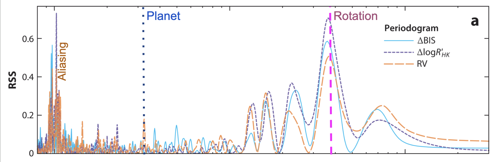
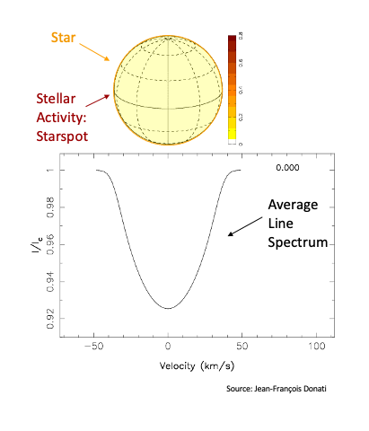

# Radial Velocities

[contents]

---

[P "Stellar Spectroscopy"]

Early spectroscopy found different spectral features and ordered A-O (with A showing the strongest Hydrogen lines)[+]

[Annie-Jump Cannon](https://en.wikipedia.org/wiki/Annie_Jump_Cannon) reordered & simplified this system, and [Cecilia Payne](https://en.wikipedia.org/wiki/Cecilia_Payne-Gaposchkin) showed the fundamentally varying parameter was **surface temperature**.

[ism="https://external-content.duckduckgo.com/iu/?u=https%3A%2F%2Fwww.researchgate.net%2Fprofile%2FXiangru-Li%2Fpublication%2F335346344%2Ffigure%2Ffig2%2FAS%3A933629706395648%401599606076448%2FThe-importance-scores-of-stellar-spectrum-features-on-the-JSP-spectral-data-The-above.png"]
<!---->

-v-
#### Stellar Spectroscopy

Stars all show a mix of two things:

1) **Blackbody emission**
  - Photons escaping hot interior[+]
  - Blackbody peak set by temperature (Wien's law)[+]
  - Hot stars: bluer, cool stars: redder[+]

-v-
#### Stellar Spectroscopy

Stars all show a mix of two things:

2) **Absorption lines**
  - Photons pass through cooler outer layers[+]
  - Atoms and/or molecules absorb photons at specific quantum transitions (e.g. electron excitation) and reemit isotropically[+]
  - This removes flux from specific wavelengths[+]
  - Which atoms/molecules (and which transitions) absorb is dependent on temperature, composition, etc.[+]
  - Line shapes are additionally impacted by environment (surface temperature & gravity)[+]

-v-
#### Stellar Spectroscopy

- We know _a priori_ what wavelength a set of absorption lines has _at rest_ (set by quantum mechanics).
- Wavelength of absorption spectra -> the velocity of a star.[+]
- Combining all spectral lines for a star (10,000s) produces the most precise possible velocity measurement.[+]

---

[P "Spectrographs"]

- The highest-resolution modern spectrgraphs use **Echelle gratings**.[+]
- This disperses a point source (from e.g. a fibre) along one dimension.[+]
- Another prism disperses the 1D light into 2D across multiple orders[+]

[ism=echelle_spectrograph.png]

-v-

### Spectrographs

-v-

### Spectrographs

- Modern spectrographs include HARPS, Maroon-X (on 6.5m Gemini), ESPRESSO (on 8m VLT), etc.
- Placed in controlled temperature/pressure conditions to minimise thermal effects on measurements (mK control).[+]
- The Echelle grating for ESPRESSO is 1.7m long & kept within a 10m$^3$ vacuum chamber[+]

[ism=https://external-content.duckduckgo.com/iu/?u=https%3A%2F%2Fwww.media.inaf.it%2Fwp-content%2Fuploads%2F2018%2F02%2Feso1806a.jpg]

---

[P "Resolution"]

- Spectral resolution is defined by the smallest difference in wavelength that can be resolved:
$R = \lambda / \Delta\lambda$; so for 500nm and 0.05nm $R = 500 / 0.05 = 10,000$;[+]
- How does this translate to velocity? [+]
$\Delta v / c = \Delta \lambda / \lambda$ [+]
- So for modern spectrographs which have $R\sim150,000$, the velocity measurement error _from a single line_ is:[+]
$\Delta v = c/R = 3e8/1.5e5 = 2000 m/s$[+]

---

[P "Extracting Readial velocities"]

### Marcy & Butler (Hamilton) approach

[ism=iodine_cell_technique.jpg]

- Need to cross-match your target star with a spectrum with known wavelength[+]
- Old approach: Observe stars through local **Iodine cell** - gas imprints absorption lines directly onto the stellar spectrum[+]
  - Position of Iodine lines may drift (local effects), but relative shifs of star to iodine should only be astrophysical[+]

-v-

### Griffin (ELODIE) approach

[ism=NIRPSSpectre_FP.jpg]

- : Observe source simultaneously (or close in time) to:[+]
  - Local lamp producing sharp emission lines of known wavelength (of Uranium, Thorium-Argon, Iodine, etc)[+]
  - Fabry-Perot (or laser frequency comb); must be calibrated nightly to emission lamp lines. Often simultaneously observed.[+]

-v-

## Template-matching cross-correlation

- We need to compare **observed** stellar spectrum with either **modelled** or **observed** (e.g. template) stellar spectrum[+]
  - Modelled spectrum means we can compute the absolute offset from rest[+]
  - Template spectrum means we only compute a velocity **relative** to the average.[+]

[ism="https://petercbsmith.github.io/gallery/ccf%20slide%20w%20cred.gif"]

-v-
## Cross-correlation masks

[ism=ccf_mask.png]

- In reality, a **mask** which marks in & outside of absorption lines (`continuum = 0`, `line = depth`) is used.[+]
- This technique was used _before detectors_ in e.g. CORAVEL. A physical "mask" was mechanically moved in front of the spectrum within the instrument directly producing the cross correlation function from which a radial velocity could be recorded.[+]

-v-

- The resulting "Cross correlation function" is the **summed response of all absorption lines as a function of velocity**.
- This easily allows radial velocity to be measured, and at a far higher precision than for a single line.[+]

-v-

- You can also measure other important metrics from the CCF such as "FWHM" (line width) and "BIS" (line assymetry).[+]
- These are good indexes to measure **stellar activity** (which can also vary radial velocity).[+]

---

[P "Planetary Signals in RVs"]

Any Keplerian motion of the star causes changes in the radial velocity.

-v-

#### What impacts the RV signal?

- Mass ratio ($K \propto M_2/M_1$)[+]
- Orbital period ($K \propto P^{1/3}$)[+]
- Orbital inclination ($K \propto \sin{i}$)[+]
- Orbital eccentricity ($K \propto (1-e^2)^{-1/2}$) [+]

-v-
#### Deriving the semi-amplitude:

$$
K = \frac{2 \pi a \sin{i}}{P\sqrt{1-e^2}} = \left(\frac{2 \pi G}{P}\right)^{1/3} \frac{M_p \sin{i}}{(M_s + M_p)^{2/3}} \frac{1}{\sqrt{1-e^2}}
$$

-v-

In more detail, we can derive it more completely:

1) The ratio in semi-major axes ($a_p/(a_p + a_s)$) is the inverse of the mass ratio ($m_p/(m_p + m_s)$). i.e. $a_s/(a_p + a_s) = m_p/(m_p + m_s)$[+]

2) Angular motion gives us orbital speed of a star/planet (assuming $e=0$): $K_p = v_s = \frac{2\pi a_s}{P}$; substituting for $a_s$, $K_p = \frac{2\pi}{P}\frac{(a_p+a_s) m_p}{m_p + m_s}$[+]

3) Kepler's third law $a^3 = G(m_p+m_s)P^2/4\pi^2$ (NB this uses relative motion, i.e. $a=(a_p+a_s)$) produces: $K_p = \frac{2\pi}{P}\frac{m_p}{m_p + m_s}\left(\frac{G(m_p+m_s)P^2}{4\pi^2}\right)^{1/3}$[+]

4) Simplifying gives: $K_p = \left(\frac{2\pi G}{P}\right)^{1/3}\frac{m_p}{(m_p + m_s)^{2/3}}$[+]

5) To adjust to _projected_ radial velocity we must include $\sin{i}$

-v-

### Improvement over time:

[Burt et al](https://arxiv.org/html/2511.01954v1)

-v- 

### Examples 1995 - Hot Jupiters

$K=60\,\rm{m}.\rm{s}^{-1}$

-v- 

### Examples 2026 - sub-Earth planets

---

## Detecting RV planets

Keplerians are **periodic**, so typically found by searching in frequency space, e.g.:[+]
- [Lomb Scargle](https://iopscience.iop.org/article/10.3847/1538-4365/aab766)[+]
- [Generalised LS](https://arxiv.org/abs/1412.0467)[+]
- [L1 periodogram](https://github.com/nathanchara/l1periodogram)[+]

-v-

---

[P "Stellar Activity"]

-v-

## Stellar Activity

- Starspots are **cooler** regions on stars where convection is suppressed
- Faculae are **hotter** regions (more sparsely concentrated)
- Activity **rotates with the stellar surface** 
- Stellar rotation typically 5-50d (Sun: 27d)[+]

-v- 

## Stellar Activity

- We can measure additional signals linked to activity, and remove their influence on the RVs.
- Techniques includes simple decorrelation, or more complex Gaussian Processes.[+]

[ism=periodograms.png]

---

[P "Modelling considerations"]

- Each instrument has a different RV zero-point[+]
  - Instruments may also have internal offsets due to changes in environmental conditions/reduction pipeline/etc.[+]
  - Some (e.g. template-matching) are fixed as median=0.0[+]
  - Others have offsets of 10-100m/s due to e.g. PSF shape, etc.[+]
  - So, for datasets with multiple observations, you need to model an offset parameter for each dataset[+]
- Long-term trends (e.g. due to binary stellar companion) can be modelled as a **polynomial** trend[+]
- For long-duration signals (e.g. P>8d), multiple RVs from one night can be averaged together[+]

-v-

### Modelling RVs

- Radial velocities act _across all data_ (unlike transits which are short duration events)
  - Different planetary signals (and different observation strategies) can complicate detection[+]
- **Harmonics** in e.g. periodograms are very common:[+]
  - Near 1 day ($1±1/p$) due to nightly observations[+]
  - Near synodic period of the moon (29.5d), especially for _bright-time_ instruments[+]
  - Near 1 year (and 1/2, 2/3, etc)[+]
- For multi-planet signals, you likely need to remove the influence of planet b to detect planet c[+]

-v-

### Model comparison

- We need quantitative evidence to say "we have found a signal". E.g.:[+]
- Bayesian Hypothesis testing between with & without the planet signal:[+]
  - Bayesian Information Criterian (BIC) to punish flexible models [+]
  - WAIC using leave-one-out (LOO) includes predictability of RV model [+]
  - log Evidence ($\log{Z}$)/Bayes factor - not possible with MCMC/HMC (requires nested sampling, e.g. with kima)[+]

---

[P "Accessing data"]

- Unlike for all-sky surveys, RVs require targetting specific stars, often with private observatories[+]
- The process of reducing extremely large raw detector images to precise RVs is often complex/resource-intensive, and even if raw data is available reduced RVs may not be.[+]
- Thus open access RV data is unfortunately rare[+]
- Exceptions are:[+]
  - Data from historical European Southern Observatory spectrographs e.g. HARPS, ESPRESSO, CORALIE (accessible on [DACE](https://dace.unige.ch/spectroscopyDatabase/?))[+]
  - Data published in publications (many also uploaded to DACE)[+]
  - Some historical surveys via Vizier (e.g. [80000 HIRES/Keck RVs on Vizier](
http://cdsweb.u-strasbg.fr/cgi-bin/qcat?J/A+A/), [spectra from SOPHIE](http://atlas.obs-hp.fr/sophie/index.html), etc)[+]
  - Solar data (e.g. [HARPS-N](https://eprv-rcn.github.io/resources/tutorials/harpsn_solar_download/), [NEID](https://neid.ipac.caltech.edu/search_solar.php), [KPF](http://koa.ipac.caltech.edu/cgi-bin/KOA/nph-KOAlogin)[+]

-v-

# Which datasets?

- Unlike previous examples, you should not presume to be able to use data on all planets - best to focus on systems with easily-accessible data[+]
- I recommend:[+]
  1. **Higher precision** echelle spectra (e.g. HARPS, CORALIE, SOPHIE)[+]
  2. **Large-amplitude signals** (e.g. Giant planets $0.2<M_p<10 M_{\rm Jup}$)[+]
- A reasonable project might study:[+]
  - One star with hundreds (or thousands) or RVs in detail [+]
  - A handful of stars with similar properties looking at trends[+]

---

[P "Project ideas"]

### General advice
- [DACE](https://dace.unige.ch/spectroscopyDatabase/?) hosts the best collection of RV data and has API/python module[+]
- Exploring what planets have data on DACE is not so simple (may be able to download archive)[+]
- While DACE does offer interactive RV fitting tools, activity detrending, etc...[+]
- It is best to download the RVs and use `kima`, `pyorbit`, `radvel`, etc.[+]
- We have strong prior information on the eccentricity of the exoplanet population (e.g. Kipping 2013); using this can help improve your fits[+]

-v-

## Project ideas:

- What's orbiting Tau Ceti (18000 RVs; 14 instruments)?[+]
- Is 51 Peg b alone?[+]
- Is the inner transiting planet visible in $pi$-Mensa RV data? How does knowledge of its period from transits change the derived parameters?[+]
- How many planets are there around HD 176986?[+]
- Given a sample of giant planets ($75<Mp<600 M_\odot$):[+]
  - Can you find any unidentified candidate planets?[+]
  - Are Hot Jupiters lonely, or often with companions planets?[+]
  - Are warm giants more eccentric than hot/cold giants?[+]
  - Does planetary mass vary a function of stellar mass and/or metallicity?[+]

-v-

## Other advice:
- Outliers likely need identifying/removing.[+]
- Could compute the stability of systems using e.g. [SPOCK](https://spock-instability.readthedocs.io/en/latest/)?[+]
